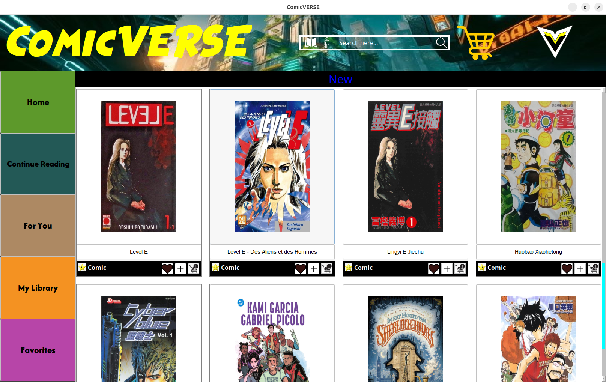
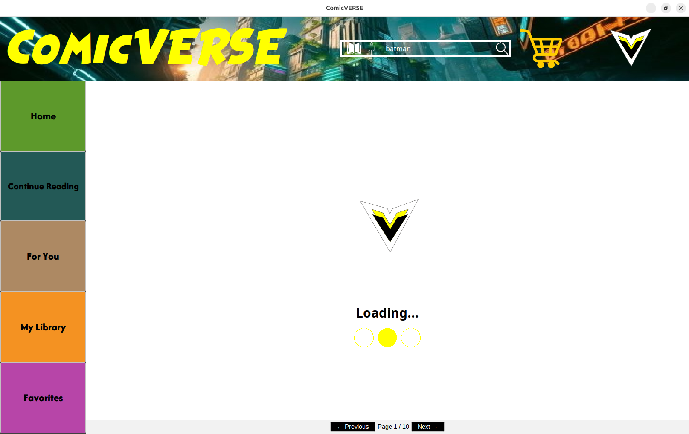
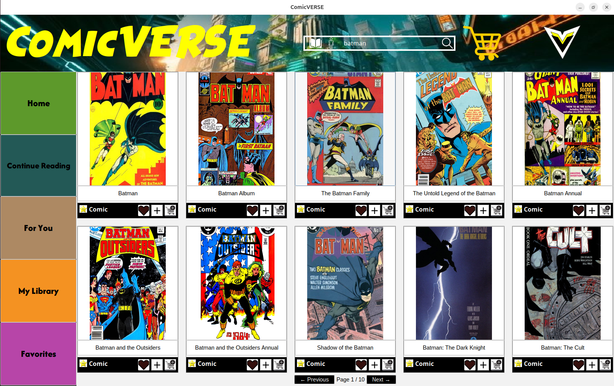

# ComicVerse

Une application Java permettant d'explorer l'univers des comics via l'API Comic Vine.

<p align="center">
  
</p>

## Description

ComicVerse est une interface graphique de visualisation et de gestion de comics qui permet aux utilisateurs de :

- Rechercher des comics et des personnages
- Gérer une bibliothèque personnelle 
- Sauvegarder des favoris
- Suivre sa progression de lecture
- Obtenir des recommandations personnalisées

## Aperçu

### Accueil

L'écran d'accueil présente les dernières sorties sous forme de grille de couvertures. Chaque carte permet, en un clic, d'ajouter le comic aux favoris (♥), à la bibliothèque (+) ou au panier. Le menu latéral donne accès aux sections **Home**, **Continue Reading**, **For You**, **My Library** et **Favorites** (voir la capture en haut de page).

### Recherche

La barre de recherche en haut de l'écran interroge l'API Comic Vine. On peut y chercher des comics (icône livre) ou des personnages (icône personnage). Pendant le chargement des résultats, une animation d'attente s'affiche :

<p align="center">
  
</p>

Les résultats s'affichent ensuite sous forme de grille paginée (boutons **Previous** / **Next**) :

<p align="center">
  
</p>


## Technologies utilisées

- Java 17
- Comic Vine API
- Swing (Interface graphique)
- Maven
- SQLite
- JUnit 5 & Mockito (Tests)
- Jackson (Parsing JSON)
- FlatLaf (Thème graphique)

## Structure du projet

```
src/
├── main/
│   ├── java/fr/tse/fise2/
│   │   ├── api/            # Accès à l'API Comic Vine
│   │   ├── controller/     # Contrôleurs MVC
│   │   ├── db/             # Gestion base de données
│   │   ├── exception/      # Exceptions personnalisées
│   │   ├── model/          # Classes modèles
│   │   ├── service/        # Services métier
│   │   └── ui/             # Interface utilisateur
│   │       ├── components/ # Composants Swing personnalisés
│   │       └── panels/     # Panneaux principaux
│   └── resources/          # Ressources (images, config, etc.)
└── test/                   # Tests unitaires
```

## Documentation

La documentation complète du projet est disponible dans le dossier `docs/` :

### Documentation Utilisateur

- [Installation et Utilisation](docs/doc_user.md)

### Documentation Technique
- [API Client et Extracteurs](docs/features/api.md)
- [Système de Recommandations](docs/features/recommandations.md)


## Licence

Ce projet est sous licence MIT. Voir le fichier [LICENSE](LICENSE) pour plus de détails.
