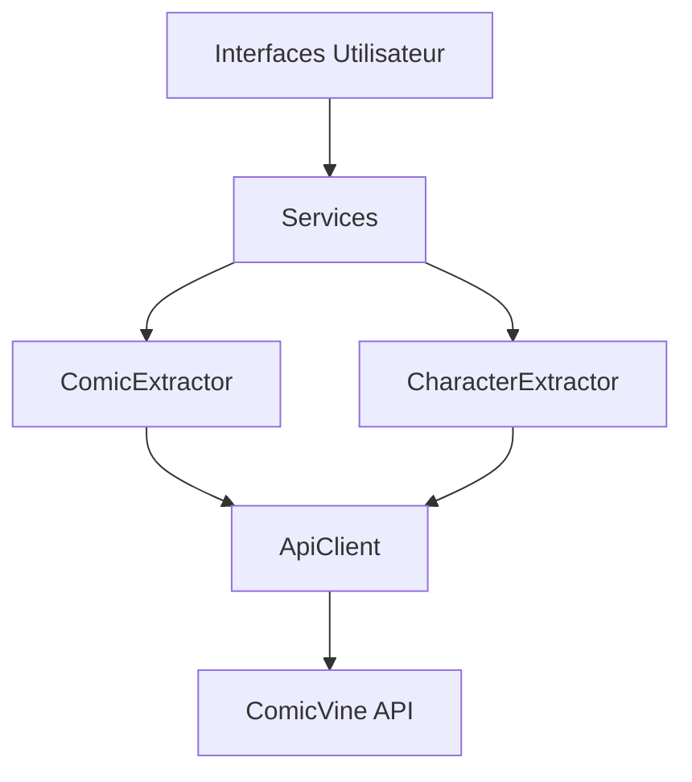
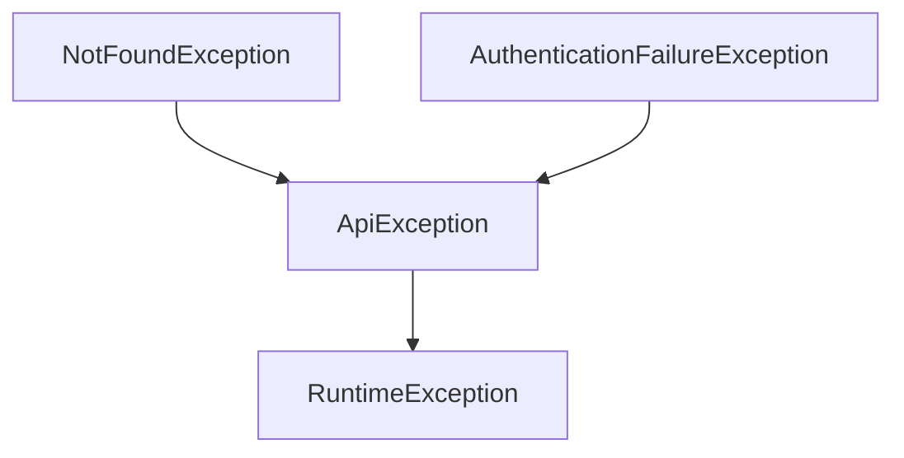

# API Client et Extracteurs

## Vue d'ensemble
Le module API fournit une interface robuste pour communiquer avec l'API ComicVine. Il est composé d'un client API générique et de deux extracteurs spécialisés pour les comics et les personnages.

## Architecture


## Composants Principaux

### ApiClient
- Point d'entrée principal pour les requêtes API
- Gestion sécurisée des clés API
- Système de logging complet
- Gestion des erreurs HTTP

Configuration:
```properties
api.key=VOTRE_CLE_API
api.base_url=https://comicvine.gamespot.com/api/
```

Exemple d'utilisation:
```java
ApiClient client = new ApiClient();
JsonNode response = client.sendRequest("volumes", "filter=name:Batman");
```

### ComicExtractor
Méthodes principales:
- getComicByName : Recherche par nom
- getComicById : Détails complets
- getRecentComics : Comics récents

Format des résultats:
```java
Comic {
    name: String,
    imageUrl: String,
    aliases: List<String>,
    description: String,
    // ...autres champs
}
```

### CharacterExtractor
Méthodes principales:
- getCharacterByName : Recherche par nom
- getCharacterById : Détails complets

Format des résultats:
```java
ComicsCharacter {
    heroName: String,
    realName: String,
    photoUrl: String,
    description: String,
    // ...autres champs
}
```

## Gestion des Erreurs

### Hiérarchie des Exceptions


### Stratégie de Logging
- Localisation : ./logs/apiclient.log
- Niveaux:
  - INFO : Requêtes réussies
  - WARNING : Problèmes mineurs
  - SEVERE : Erreurs critiques

## Tests

### Tests des Extracteurs
```java
// Tests ComicExtractor
@Test
public void testGetComicByName() throws ApiException {
    List<Comic> comics = ComicExtractor.getComicByName(apiClient, "Spider-Man");
    assertEquals("Marvel Team-Up Featuring Spider-Man", comics.get(0).getName());
}

// Tests CharacterExtractor
@Test
public void testGetCharacterById() throws ApiException {
    ComicsCharacter character = CharacterExtractor.getCharacterById(apiClient, 60535);
    assertEquals("Skrull Spider-Man", character.getHeroName());
    assertTrue(character.getIssueCredits().contains("Secret Invasion"));
}
```

### Tests d'Intégration
Tests effectués directement avec l'API ComicVine en utilisant une clé API valide.
Chaque méthode est testée avec des cas réels pour vérifier:
- La récupération des données
- Le formatage correct
- La gestion des erreurs

## Bonnes Pratiques

### Rate Limiting
- Limitation automatique des requêtes
- Cache des résultats fréquents
- Gestion des quotas API

### Sécurité
- Stockage sécurisé des clés API
- Validation des entrées

### Performance
- Minimisation des requêtes
- Optimisation des champs retournés
- Mise en cache intelligente

## Maintenance
- Vérification régulière des logs
- Monitoring des quotas API
- Mise à jour des schémas de données

## Intégration
### Exemple d'intégration UI
```java
public class ComicSearchPanel {
    private final ApiClient client;
    private final ComicExtractor extractor;

    public void searchComics(String query) {
        try {
            List<Comic> results = extractor.getComicByName(client, query);
            updateUI(results);
        } catch (ApiException e) {
            handleError(e);
        }
    }
}
```

### Dépendances
- Jackson (JSON)
- Java HTTP Client
- SLF4J (Logging)
