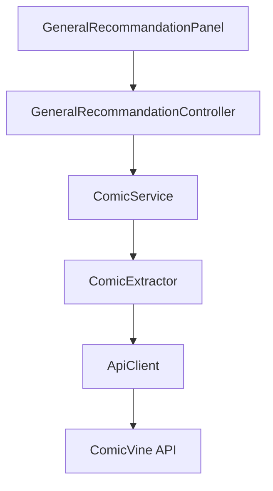

# Système de Recommandations Générales

## Vue d'ensemble
Le système de recommandations permet d'afficher les comics les plus récents sur la page d'accueil de l'application. Cette fonctionnalité utilise l'API ComicVine pour récupérer et afficher les 20 dernières sorties de comics dans une grille interactive.

## Architecture


## Composants Principaux

### UI (GeneralRecommandationPanel)
- Layout principal : BorderLayout
- Éléments :
  - Label titre "New" (style personnalisé)
  - Grille 4xN de ComicCards
  - ScrollPane avec barre personnalisée
- Fonctionnalités :
  - Rafraîchissement dynamique
  - Gestion du cache des recommandations

### Contrôleur (GeneralRecommandationController)
- Point d'entrée : fetchGeneralRecommendations()
- Gestion de la couche service
- Propagation des exceptions API

### Service (ComicService)
- Configuration : DEFAULT_RECOMMENDATION_LIMIT = 20
- Délégation des appels à ComicExtractor
- Gestion du client API

### Extracteur (ComicExtractor)
Méthodes principales:
- getComicByName(apiClient, name)
- getComicById(apiClient, id)
- getRecentComics(apiClient, limit)

### Client API (ApiClient)
- URL Base : https://comicvine.gamespot.com/api/
- Fonctionnalités :
  - Gestion des clés API
  - Logging complet
  - Validation des réponses
  - Gestion des erreurs HTTP

## Gestion des Erreurs
- ApiException personnalisée
- Logging des événements
- Validation des données
- Gestion du cache

## Tests
### Tests Unitaires Disponibles
- GeneralRecommandationControllerTest
- ComicServiceTest
- ComicExtractorTest
- ApiClientTest

### Exemples de Tests
```java
// Test du contrôleur
@Test
void testFetchGeneralRecommendations() {
    List<Comic> comics = controller.fetchGeneralRecommendations();
    assertEquals(20, comics.size());
}

// Test du cache
@Test
void testCaching() {
    List<Comic> first = controller.fetchGeneralRecommendations();
    List<Comic> second = controller.fetchGeneralRecommendations();
    assertEquals(first, second);
}
```

## Configuration
```properties
# config.properties
api.key=VOTRE_CLE_API

# logging.properties
logging.level=INFO
```

## Logs
- Localisation : ./logs/apiclient.log
- Format : SimpleFormatter
- Niveaux : INFO, WARNING, SEVERE

## Maintenance
### Rafraîchissement UI
```java
public void refreshPanel() {
    // Met à jour l'interface avec les données en cache
}
```

### Cache
- Mise en cache au niveau du contrôleur
- Invalidation automatique : non implémentée
- Rafraîchissement manuel : via refreshPanel()

## Intégration
### Composant ComicCard
- Affiche les informations basiques
- Image de couverture
- Nom du comic
- Description courte

### Dépendances
- Jackson (parsing JSON)
- JUnit 5 (tests)
- Java HTTP Client
- Swing (UI)